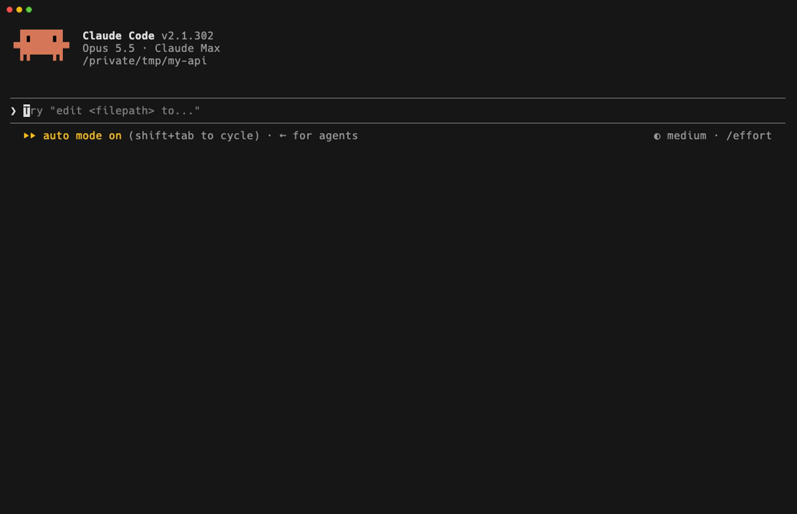

# open-questions

A Claude Code plugin that keeps the questions Claude asked you in a box above the prompt, until you answer them.

Claude often asks something in the middle of a long reply, then keeps writing. The question scrolls away under the text that follows, and you answer only what you saw last. With this plugin, Claude files each question it asks in a box above the prompt. It stays there until you answer it, or until it no longer applies.



The story behind it: [The Warning My Agent Gave That I Never Saw](https://jack.direct/blog/the-warning-my-agent-gave-that-i-never-saw).

## Install

```
/plugin marketplace add jaklimoff/claude-open-questions
/plugin install open-questions@open-questions
```

Or in one step from the shell (v2.1.292+): `claude plugin install open-questions --marketplace jaklimoff/claude-open-questions`.

Needs Claude Code v2.1.293 or later (mods shipped in v2.1.287; `isDeferred` needs v2.1.293). Tested with v2.1.302. Mods can change between releases, so if the box stops drawing after an update, check the [mods changelog](https://code.claude.com/docs/en/changelog).

Tested in the terminal. Mods don't draw the band above the prompt in the VS Code extension, or anything in `claude -p`. Questions live in session state, so `/clear`, `/resume` and `/branch` start an empty list.

Filing a question is up to the model, which follows the tool's description. In a quick test, Opus 5.5 filed its questions and Sonnet 5.5 wrote them as plain text instead, so check with the model you use.

The box uses Nerd Font glyphs. Without a Nerd Font in your terminal, the icons show as empty squares.

## What it can touch

A mod is code that runs inside Claude Code with your permissions, so read it before you install it. This one uses only `$.state` (the list, in memory for the session), `$.tool.register` (the `questions` tool), `$.prompt.submit` (sending your drafted answers) and `$.ui.resolve` / `$.ui.focus` (drawing the box). No files, no processes, no network, no model calls. `claude plugin validate .` prints the same list for any mod.

## Use

- Claude files each question it asks with the `questions` tool. You do nothing.
- Press the pencil next to a question, type the answer, press Enter. The answer is kept as a draft and the next question opens. An empty Enter skips it.
- **send** sends all drafts in one message. Any prompt you type also carries the drafts, after your text.
- `ctrl+x tab` focuses the box, with the first unanswered question already open.
- The cross (on hover) drops a question without an answer. The chevron folds the box to one line.
- Each prompt reminds Claude of the open questions, so it closes the ones your message answered or made moot.

## How it works

The whole plugin is one file, `hooks/open-questions.tsx`, about 250 lines. It is a Claude Code mod: a plugin whose `hooks/hooks.json` lists a module that runs inside Claude Code ([mods docs](https://code.claude.com/docs/en/plugins/mods/overview)). It hooks four events:

| Event | What it does |
|---|---|
| `session.start` | Registers the `questions` tool: `ask` adds questions, `answered` closes them by id. The tool description tells Claude when to call it. |
| `tool.call` | Handles the tool: keeps the open questions in plugin state (`atom`), hands out ids in one `update` so parallel calls never share one. |
| `prompt.submit` | Adds your drafted answers to the message, and the list of open questions to the context Claude sees. |
| `ui.render` (`AbovePrompt`) | Draws the box with `Box`, `Text`, `Button` and `Input`. |

The tests in `tests/open-questions.test.ts` show each behaviour. Run them with:

```
claude plugin test .
```

For development, start Claude Code with `claude --plugin-dir <path to this folder>`.

## Build your own

This plugin is small on purpose. Fork it, keep the four hooks, and change what they track: TODOs Claude promised, files it said it would come back to, warnings it gave. Claude Code can write most of it for you. The work is in the tuning afterwards, one edge case at a time.

## Contributing

Issues and PRs welcome. Run `claude plugin validate --strict .` and `claude plugin test .` before sending one.

## License

MIT
